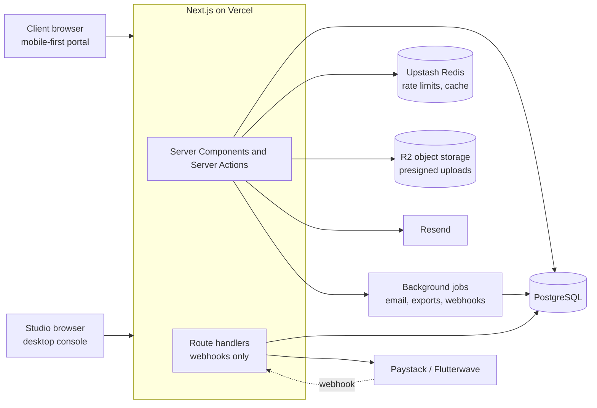

# Cadence: client delivery portal

Cadence lets a studio send a proposal, get it signed, collect milestone payments (NGN and USD), manage change requests and hand over deliverables. Clients sign in with a magic link and approve work from a mobile-first portal. Studio members run projects from a desktop console.

> **Status: foundation build.** This build sets up the project, design tokens, shared primitives, icon map, environment validation and documentation. Most of the product is not built yet. See [Status](#status) and [docs/route-map.md](docs/route-map.md).

## Status

| Area | State |
|---|---|
| Design tokens (colour, type, radius, shadow, motion) | Done. Tailwind v4 `@theme`, light and dark. |
| Shared primitives: Button, StatusChip, MilestoneStepper | Done. Not yet tested in a browser or with axe-core. |
| Icon map (Material to lucide) | All 261 names used in the screens mapped (100% of uses). lucide export names unverified until install. |
| Environment validation at boot | Done. Fails fast with a message naming each bad variable. |
| Security headers (CSP, HSTS, and others) | Done. CSP allows inline scripts for now. |
| Placeholder home page and 404 | Done. The real landing page is not built. |
| Architecture (repositories, transactions) | Planned in ADR 0006. Not started. Recommended after the first install. |
| Routes | 40 page files. Ported to their designs: landing, pricing, log-in, sign-up, onboarding, account, email check, expired link, 404, invitation, proposal review, billing. Still to port: sign-off, signed, and the other client and studio pages (see docs/design-decisions.md). |
| Database schema | Written (`db/schema.ts`). No migrations generated yet, because that needs a database. Seed not written. |
| Authentication (magic link) | Implemented with Better Auth. Not run: needs a database, migrations and the library version confirmed. |
| Payments | Paystack implemented with a verified webhook. Not run. Flutterwave fallback not built. |
| Email templates (4) | Not built. |
| Tests | Unit tests written for money, dates and retainer totals (`tests/unit`). Not run: no install in this environment. Playwright, axe-core and Lighthouse CI not built. |
| CI workflow (GitHub Actions) | Not built. |
| Observability (Sentry, tracing) | Not built. |
| Lockfile | Not committed. Generated on the first install. |

The package versions are unverified. See [docs/versions.md](docs/versions.md) before the first install.

What has been checked, and what has not, is recorded in [docs/verification.md](docs/verification.md). Short version: the domain logic and its 59 unit tests pass, and the imports and Next.js boundaries are consistent. The React pages, Next.js runtime, Better Auth, Paystack and the database have not been run.

## Stack

| Layer | Choice | Why (see ADR) |
|---|---|---|
| Framework | Next.js App Router, TypeScript strict | [0001](docs/adr/0001-framework.md) |
| Styling | Tailwind CSS v4, CSS-first tokens | [0005](docs/adr/0005-styling-and-icons.md) |
| Icons | lucide-react only | [0005](docs/adr/0005-styling-and-icons.md) |
| Variants | class-variance-authority, tailwind-merge | [0005](docs/adr/0005-styling-and-icons.md) |
| Validation | Zod 4 (shared client and server schemas, planned) | Brief section 2 |
| Font | Inter via `next/font` | [design-decisions](docs/design-decisions.md#typography) |
| Database | PostgreSQL, Drizzle ORM (planned) | [0002](docs/adr/0002-data-layer.md) |
| Auth | Better Auth, magic link (planned) | [0003](docs/adr/0003-authentication.md) |
| Payments | Paystack (built), Flutterwave fallback (not built) | [0004](docs/adr/0004-payments.md) |
| Hosting | Vercel | [assumptions](docs/assumptions.md) |

## Architecture



Every box on the right is planned, not built. The diagram shows the intended design.

## Getting started

The first install has not been run. Follow [docs/first-run.md](docs/first-run.md) for the order of steps and the failures to expect.


Requirements: Node.js 24 (see `.nvmrc`), pnpm, and a PostgreSQL database.

```bash
corepack enable
pnpm install            # first install creates pnpm-lock.yaml. Commit it.
cp .env.example .env.local
# Fill in DATABASE_URL and AUTH_SECRET at least. See .env.example.
pnpm dev                # http://localhost:3000
```

If a required variable is missing or malformed, the server stops at boot and names the variable.

## Scripts

| Script | What it does |
|---|---|
| `pnpm dev` | Starts the development server |
| `pnpm build` | Production build |
| `pnpm start` | Serves the production build |
| `pnpm typecheck` | `tsc --noEmit` in strict mode |
| `pnpm lint` | ESLint, flat config, Next.js rules |
| `pnpm format` | Prettier, writes changes |
| `pnpm test` | Unit tests (Vitest), run in CI |
| `pnpm check:static` | Import, export and Next.js boundary checks. No dependencies. |

Tests, database and migration scripts are not in `package.json` yet.

## Environment variables

Full list with comments: [.env.example](.env.example). Summary:

| Name | Required | Scope | Purpose |
|---|---|---|---|
| `DATABASE_URL` | yes | server | PostgreSQL connection string |
| `AUTH_SECRET` | yes | server | Signs sessions and magic links. At least 32 characters. |
| `APP_URL` | yes | server | Public origin, used in email links |
| `RESEND_API_KEY`, `EMAIL_FROM` | optional now | server | Transactional email |
| `PAYSTACK_SECRET_KEY` | optional now | server | Payments, primary |
| `FLUTTERWAVE_SECRET_KEY` | optional now | server | Payments, fallback |
| `UPSTASH_REDIS_REST_URL`, `UPSTASH_REDIS_REST_TOKEN` | optional now | server | Rate limits and cache |

No variable is `NEXT_PUBLIC_`. None is available in the browser. `lib/env.ts` must be imported only from server code.

## Project structure

| Path | Purpose |
|---|---|
| `app/` | App Router. `(marketing)` holds public pages. Route groups for client, studio and auth are added with their routes. |
| `app/layout.tsx` | Root layout: font, metadata, body styles |
| `components/ui/` | Shared primitives: Button, StatusChip, MilestoneStepper |
| `components/layout/` | Header, footer, sidebar, page shell (not built) |
| `components/features/` | Feature components by domain (not built) |
| `lib/` | Utilities (`cn`), env validation (`env.ts`), icon map (`icons.ts`) |
| `lib/services/` | Integration adapters, one per provider, with a mock for development (not built) |
| `server/` | Data-access functions and Server Actions (not built) |
| `db/` | Schema, migrations and seeds (not built) |
| `emails/` | Transactional email templates (not built) |
| `styles/` | Global CSS and design tokens |
| `tests/` | Unit, end-to-end and visual tests (not built) |
| `docs/` | Audit, route map, tokens, decisions, assumptions, versions, ADRs, icon map |
| `instrumentation.ts` | Validates environment at boot |

## Design system

- Tokens: [docs/design-tokens.md](docs/design-tokens.md). Source: the Stitch export's `DESIGN.md`.
- Canonical values where the screens disagreed: [docs/design-decisions.md](docs/design-decisions.md).
- Breakpoints: phone below 640px, tablet from 640px, desktop from 1024px, max width 1440px.
- Icons: [docs/icon-map.md](docs/icon-map.md).
- Components: Button (primary, secondary, ghost, destructive; sm, md, lg; loading), StatusChip (waiting, done, critical), MilestoneStepper (six stages).

## Responsive and accessibility commitments

- Mobile-first CSS. Targets at 320, 375, 414, 768, 1024, 1280, 1440 and 1920 px. Not yet tested at these widths.
- Touch targets at least 44 by 44 CSS px. Enforced in the Button component.
- Colour is never the only signal. Status chips pair an icon with text.
- `prefers-reduced-motion` is honoured in the base styles.
- Focus rings are 2px `--color-primary` with a 2px offset.
- Not yet verified: axe-core, 200% zoom, screen reader behaviour.

## Known limitations

- **Not a working product.** Nothing in the designs is wired. Every control in the exports was inert, and none of the product routes exists yet.
- **Unverified versions.** Packages were not checked against their official sources. See docs/versions.md.
- **No lockfile.** Generated on first install.
- **CSP uses `unsafe-inline` for scripts.** Move to nonce-based CSP before launch.
- **Icon names checked on install.** Every name used in the screens is mapped. The first real install found five names missing from lucide-react 0.383.0; they are replaced (docs/assumptions.md, item 97), and lucide-names checks the rest after every install.
- **Logo is text.** The Stitch logo was a hosted raster. The client needs to supply a vector logo.
- **Two schematic illustrations are not yet local.** See docs/audit.md, finding 12.
- **Dark mode has tokens but no toggle.**
- **Client project home runs on fixture data.** The page reads `db/fixtures`, and a development-only viewer stands in for sign-in.
- **Sign-off stores a typed-name record in memory.** It is not a qualified electronic signature. See docs/assumptions.md, items 26 and 29.
- **Sign-in is untested.** The Better Auth API is written from memory. See docs/assumptions.md, items 31 to 36.
- **Files need object storage.** Uploads, downloads, removal and the cleanup job are written and unit tested, but have not run against a live bucket. Configure STORAGE_* variables first. File records are in memory. See docs/assumptions.md, items 81 to 91.
- **Notifications need the database outbox.** It is written and tested in memory, but the production store and the migration have not been run. Until they are, notifications are lost on restart. See docs/assumptions.md, items 76 to 80.
- **Studio writes and invitations are in memory.** Sending needs an accepted invitation. See docs/assumptions.md, items 49 and 54 to 59.
- **No route-protection middleware.** Each page checks the session itself.
- **Payments are untested against Paystack.** The adapter and webhook follow Paystack's documented API from memory. Use test keys first.
- **Escrow and compliance badges are not carried over.** See docs/assumptions.md, item 20.
- **No CI, observability or background jobs.**

## Troubleshooting

- **`Cannot start: invalid or missing environment variables`.** The message names the variable. Check `.env.local` against `.env.example`.
- **Icon import error after an upgrade.** lucide renames icons between releases. Fix the export name in `lib/icons.ts`. Pages do not need changes.
- **Build fails on `typedRoutes`.** A link points to a route that does not exist yet. Check `docs/route-map.md`.

## Contributing

- Branches: `feat/<area>-<short-name>`, `fix/<short-name>`, `docs/<short-name>`.
- Commits: Conventional Commits (`feat:`, `fix:`, `docs:`, `chore:`).
- A pull request needs a passing `pnpm typecheck`, `pnpm lint` and `pnpm build`. Tests and CI are not yet required because they do not exist.
- A change to a design token or a decision needs an update to `docs/design-decisions.md`. A significant technical choice needs an ADR in `docs/adr/`.

## License

License: TBD (placeholder). Choose before any external distribution.
